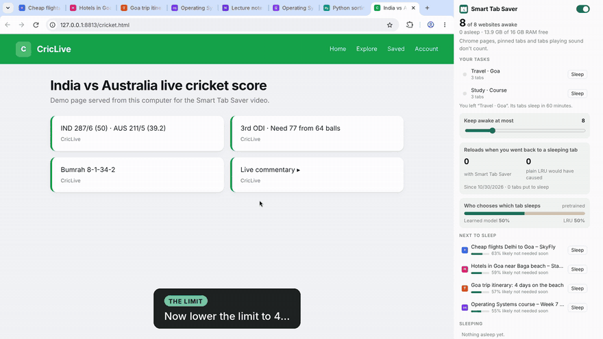

# Smart Tab Saver
 
A Chrome extension that keeps only the tabs you need awake, choosing which tabs to put to sleep with a policy learned from Belady's optimal page-replacement algorithm, and a phone app to see and control your laptop's tabs from your phone.

Manifest V3 · Chrome 116 or later · plain JavaScript ES modules, no build step and nothing to install (one small QR code library is included) · phone app for Android and iPhone at **[rajveer-lab.github.io/oschromium/app](https://rajveer-lab.github.io/oschromium/app/)**

**What you get**

- **Fewer tabs eating memory.** Only as many websites as you choose stay loaded (8 by default); the rest sleep in the tab strip and reload when you click them.
- **Smart choices.** A small model trained to imitate the optimal algorithm picks which tab sleeps, LRU steps in when the model isn't sure, and the popup shows how you're doing against plain LRU.
- **Tasks.** Tabs are grouped into tasks such as "Travel · Goa"; a task you've left sleeps together.
- **Context.** Fewer tabs stay awake on battery, during a video call or while you're away; heading for the tab bar wakes the tab you'll want next.
- **Your phone.** Opening YouTube on your phone pauses it on the laptop, and the phone app lets you sleep, wake, close, pause or open your laptop's tabs.
- **Private.** Everything is worked out on your computer; what goes to your phone is encrypted end to end.

**Contents:** [Demo](#demo) · [Install](#install) · [The idea](#the-idea-tabs-are-pages) · [How it picks the tab to sleep](#how-it-picks-the-tab-to-sleep) · [Smart features](#smart-features) · [Phone app](#phone-app) · [The popup](#the-popup) · [Results](#results) · [Privacy and permissions](#privacy-and-permissions) · [Tests](#tests) · [Project structure](#project-structure) · [Authors](#authors)

## Demo

[](https://drive.google.com/file/d/1zC7HcSF-0APsv2wK4xu38vv_f1qBksJv/view?usp=sharing)

**[Watch the full demo (4:21)](https://drive.google.com/file/d/1zC7HcSF-0APsv2wK4xu38vv_f1qBksJv/view?usp=sharing)**

The video walks through the awake-tab limit, reloads compared with LRU, task focus, predictive wake, call mode, green mode and "Learn from my browsing". Phone handoff and the phone app came later and aren't in the video. It was recorded in Chromium with the extension loaded unpacked. The websites are local stand-in pages, the grace period and task timer were shortened so effects show within seconds, and the battery event was sent by the demo script (the recording machine has no battery).

## Install

1. Get the code, either way:
   - **Download:** on this page click **Code → Download ZIP**, then unzip it.
   - **Clone:**
     ```bash
     git clone https://github.com/rajveer-lab/oschromium.git
     ```
2. Open `chrome://extensions` and turn on **Developer mode**.
3. Click **Load unpacked** and choose the folder that has `manifest.json` directly inside it. On Windows, unzipping often makes `oschromium-main\oschromium-main`: pick the inner one.
4. Click the Smart Tab Saver icon in the toolbar (pin it from the puzzle-piece menu) to open the popup.
5. Optional: connect your phone, see [Phone app](#phone-app).

**Updating:** get the new code into the same folder (`git pull`, or unzip over it), then click the reload arrow on Smart Tab Saver in `chrome://extensions`. If you load a different folder instead, remove the old copy first.

## The idea: tabs are pages

Every open tab holds memory, but you only work with a few at a time. Smart Tab Saver manages tabs the way an operating system manages pages:

| Operating system | Smart Tab Saver |
|---|---|
| Page | Tab |
| Memory size C | "Keep awake at most" (default 8 websites) |
| Page reference | Opening or switching to a tab |
| Eviction | Putting a tab to sleep with `chrome.tabs.discard` (it stays in the tab strip) |
| Page fault | Going back to a sleeping tab, which has to reload |
| Belady's OPT | The teacher the model is trained to imitate |
| LRU | The fallback, and the baseline every decision is measured against |

## How it picks the tab to sleep

1. **Score.** Each tab that may sleep gets a probability that it won't be needed soon, from a logistic regression over eight features of its history: age, use count, the last three gaps between uses, mean gap, how overdue it is (age ÷ mean gap) and whether it was used more than once. The model was trained offline to imitate OPT: a tab is labelled "not needed soon" if its next use is more than 2 × C switches away.
2. **Fall back.** If even the best score is below the confidence threshold (default 50%), the least recently used tab sleeps instead.
3. **Regret guard.** Going back soon to a tab that slept counts against whichever of the model or LRU chose it, and trust shifts between the two (multiplicative weights). The popup shows the current split as a trust bar.
4. **Keep score.** A shadow LRU runs on the same switches with the same limit and protections, so the popup can show your reloads next to the ones plain LRU would have caused.

Tabs from the task you're working on are the last to go.

### What never sleeps

- The tab you're looking at, and any tab opened or switched to in the last 60 seconds
- Chrome's own pages, pinned tabs (unless you turn that off) and tabs playing sound
- Sites you exclude in Settings
- Tabs where you typed into a form and haven't submitted (optional, needs permission)
- The tab you're in a call on

## Smart features

Each one can be switched on or off in the popup, with a "Why?" that explains it.

| Feature | What it does | Default |
|---|---|---|
| **Task focus** | Groups your tabs into tasks from their titles, site names and addresses (TF-IDF and average-linkage clustering, on this computer). When you've left a task for 2 minutes and 3 tab switches, its tabs sleep together. Tasks can also be shown as Chrome tab groups. | On |
| **Predictive wake** | Moving the mouse quickly up toward the tab bar wakes the sleeping tab you'll most likely open next: the one you usually go to from this tab, or the latest tab of the same task. Pointing at a sleeping tab in the popup wakes it too. | Off (needs site permission) |
| **Away & handoff** | A video you paused and left for 10 minutes sleeps, and half as many tabs stay awake while you're away (5 minutes without input, or a locked screen). Optional handoff: when the same video starts on your other Chrome device, the paused one here sleeps. Optional phone handoff: opening YouTube on your phone pauses YouTube here and puts its tab to sleep (see below). | On (both handoffs off) |
| **Green mode** | On battery, with the CPU at 75% or more, or with a high-carbon power grid (optional, free [Electricity Maps](https://www.electricitymaps.com/) key), the limit drops to three quarters and the model may act on lower confidence. | On |
| **Call mode** | During a video call in the browser (Meet, Zoom, Teams, Webex, Slack, Discord, Whereby), half as many tabs stay awake. It only notices that the call site turned your microphone or camera on or off. | Off (needs permission for the call sites) |

When several modes apply, the strictest limit wins, and the limit never drops below 2.

### Phone handoff: YouTube from laptop to phone

Watching YouTube on the laptop and then opening the YouTube app on your phone pauses the laptop's video within a few seconds and puts its tab to sleep. When you go back to the tab, the video starts again where it was paused. If you're looking at the YouTube tab at that moment, the video is paused but the tab stays awake.

Chrome on phones doesn't run extensions, and YouTube doesn't tell other devices what you play, so a small automation on the phone sends the signal:

1. **Turn it on.** In the popup, under Away & handoff, tick "Pause and sleep YouTube here when I open YouTube on my phone", or tick it in Settings and click **Save**. Settings then shows **your phone's link**, a private address on the free [ntfy.sh](https://ntfy.sh) relay. Click **Copy**.
2. **Set up the phone.**

   **Android:** install the free [MacroDroid](https://www.macrodroid.com/) app and add a macro:
   - **Trigger:** Application Launched → YouTube
   - **Action:** HTTP Request, method GET, URL: your phone's link

   Save it, and turn off battery optimisation for MacroDroid so it can run in the background.

   **iPhone (iOS 17 or later):** use the built-in Shortcuts app, nothing to download:
   1. Open **Shortcuts**, go to the **Automation** tab and tap **+** (or **New Automation**).
   2. Choose **App**, tap **Choose**, pick **YouTube** and make sure **Is Opened** is ticked.
   3. Select **Run Immediately** (optionally turn off **Notify When Run**) and tap **Next**.
   4. Tap **New Blank Automation** → **Add Action**, search for **Get Contents of URL** and tap it.
   5. Tap the **URL** field, paste your phone's link and tap **Done**.
3. **Try it.** Play a YouTube video on the laptop, switch to another tab and open YouTube on your phone. The laptop's video pauses and its tab sleeps, labelled "playing on your phone". **Send a test signal** in Settings does the same from the laptop, without the phone.

How it works: the extension listens to its private topic on the relay over a WebSocket and checks the relay every 30 seconds as a backstop. On a signal less than 2 minutes old, it pauses any video playing on YouTube, puts the time it stopped at in the address (`t=`), and puts the tab to sleep. Only the signal goes through the relay, never what you watch. Anyone with the link could pause YouTube on your laptop, so keep it to yourself; **New link** in Settings replaces it.

### Learn from my browsing

The button in the popup retrains the model on your own tab switches (the last 5,000). Your history is replayed under OPT, every moment a tab had to sleep becomes a labelled example, and a new logistic regression is fitted by Newton's method. The new model is kept only if, replayed on that same history, it causes no more reloads than the current one. It needs more distinct tabs than your limit and at least 100 training examples, and it all stays on your computer. Settings has a button to go back to the pretrained model.

## Phone app

See the tabs open on your laptop from your phone, and control them from there. It works on Android and iPhone, with nothing to install from an app store: it's a web app at **[rajveer-lab.github.io/oschromium/app](https://rajveer-lab.github.io/oschromium/app/)** that you add to your home screen.

| On your phone you see | And can |
|---|---|
| Every website open on the laptop, grouped into your tasks | **Sleep** a tab, to free the laptop's memory |
| Which tabs are awake, asleep, playing or on screen | **Wake** a sleeping tab, so it's ready when you sit down |
| How many websites are awake out of the limit | **Pause** or **Play** a video |
| | **Open on phone**, to carry on reading there |
| | **Close** a tab (tap twice) |
| | **Pause YouTube on my laptop**, one big button |

**Connect your phone (once):**

1. On the laptop, click the Smart Tab Saver icon, then **Phone app** at the bottom of the popup.
2. Tick **Let my phone see and control the tabs in this browser**. A QR code appears.
3. Scan the QR code with your phone's camera. The app opens, already connected.
4. Add it to your home screen:
   - **Android:** in Chrome's menu ⋮ choose **Install app** or **Add to Home screen**.
   - **iPhone:** tap **Copy pairing code** in the app, then Share → **Add to Home Screen**. Open the new icon and paste the code once (iPhone keeps home-screen apps separate from Safari).

**Disconnect all phones** in Settings makes a new key, so every phone connected before stops working until it scans the new QR code.

**Privacy.** The QR code holds a random encryption key, in the part of the address after `#`, which browsers never send to a server. The laptop and the phone encrypt everything with it (AES-GCM) before it goes through the free [ntfy.sh](https://ntfy.sh) relay, so the relay only ever passes scrambled data. The phone gets tab titles (cut to 90 characters) and site names; a full address is sent only when you tap **Open on phone**. The laptop ignores commands that don't decrypt with the key, that are older than 2 minutes or that it has seen before. It sends tab lists only while the app is open, and for 5 minutes after.

## The popup

From top to bottom: how many websites are awake out of the limit and how much RAM is free; the tasks found in your tabs; the "Keep awake at most" slider; reloads with Smart Tab Saver next to plain LRU; the trust bar between the model and LRU; the tabs next in line to sleep, with the model's score; the sleeping tabs, each with the reason it slept; the five smart features; and "Learn from my browsing". The switch in the header pauses the extension.

Settings (the link at the bottom of the popup) holds the protections, the confidence threshold, excluded sites, the task timer, tab groups, the away and paused-video timers, handoff, phone handoff (your phone's link, a test signal and a new link), the phone app's QR code, the Electricity Maps key and zone, and buttons to reset the model or the reload counts. **Phone app**, also at the bottom of the popup, goes straight to the QR code.

## Results

From our Review 3 report: a trace-driven simulation over 30 synthetic task-structured browsing strings of 1,200 switches each, with the limit at C = 8.

| Policy | Reloads per 1,200 switches |
|---|---|
| Belady OPT (lower bound) | 54.9 |
| LRU | 124.1 |
| Smart Tab Saver (model + fallback + regret guard) | 134.7 |
| Learned model alone | 247.1 |

- On task-structured browsing LRU is hard to beat. The shipped hybrid stays within 12% of LRU at every limit tested, while the model alone would double the reloads.
- Where LRU breaks down, on a loop over 10 tabs, the model causes 410 reloads against 1,190 for LRU (OPT: 264).
- Retraining on a user's own first 600 switches cut the model's reloads on the next 600 by 25% (109.3 → 81.5).
- Task clustering grouped 27 realistic tabs into 8 tasks with an adjusted Rand index of 0.87 and no wrong merges.

## Privacy and permissions

Everything is worked out on your computer and kept in `chrome.storage.local`. Four things leave it, and only if you turn them on: handoff shares a scrambled code of the playing video's address (never the address) through Chrome sync, phone handoff listens for your phone's signal on your private ntfy.sh topic, the phone app exchanges your tab list and commands with your phone, encrypted end to end, through ntfy.sh, and green mode asks Electricity Maps for your zone's grid carbon if you add a key. The page scripts never read or send what you type or what's on the page.

| Permission | Used for |
|---|---|
| `tabs` | Seeing tab switches, putting tabs to sleep and waking them |
| `storage` | Settings, tab history and reload counts (local); the handoff code (sync) |
| `alarms` | Checking the limit once a minute |
| `scripting` | Registering the optional page scripts |
| `system.memory`, `system.cpu` | Free RAM in the popup; CPU load for green mode |
| `idle` | Noticing when you're away |
| `offscreen` | Reading the battery status for green mode |
| `tabGroups` | Showing tasks as tab groups (optional) |
| Site access (optional, asked for when needed) | Typing protection and predictive wake (all sites); call mode (the call sites); phone handoff and the phone app (youtube.com and ntfy.sh); grid carbon (api.electricitymap.org) |


## Tests

The end-to-end suite (82 checks) loads the extension into real Chromium under Xvfb (Linux) and checks every feature: the limit, task detection, task focus, predictive wake, call mode, green mode, handoff, phone handoff and the phone app (with a local stand-in for the relay, including the app itself, its encryption and its refusal of wrong-key, stale and replayed commands), paused video and away, tab groups, and the popup and settings pages.

```bash
tests/build.sh && tests/run.sh
```

`tests/build.sh` builds a test copy in `tests/ext` with local stand-ins for the call sites, the carbon API and the ntfy relay; `tests/collector.py` serves them, and the phone app, while the tests run. Set `CHROME` to a Chromium or Chrome for Testing binary if it isn't found; branded Google Chrome no longer loads unpacked extensions from the command line.

## Project structure

| File | What it does |
|---|---|
| `manifest.json` | Manifest V3: permissions, service worker, popup, icons |
| `background.js` | Service worker: tab switches, regret guard, enforcing the limit, smart features, learning |
| `policy.js` | Features, pretrained model, OPT labelling, logistic regression, replay |
| `rules.js` | Which tabs count and may sleep, default settings, the current limit |
| `tasks.js` | Task clustering: TF-IDF and average-linkage clustering of tabs |
| `popup.html`, `popup.css`, `popup.js` | The toolbar popup |
| `options.html`, `options.js` | The settings page |
| `content-typing.js` | Notices unsaved form input |
| `content-intent.js` | Notices the mouse heading for the tab bar |
| `content-call.js`, `content-call-relay.js` | Notice a call's microphone and camera turning on or off |
| `offscreen.html`, `offscreen.js` | Battery status for green mode |
| `tests/` | `build.sh`, `run.sh`, the test runner (`harness/`) and local test pages (`site/`) |
| `docs/app/` | The phone app (installable web app): `index.html`, `app.js`, `app.css`, `link.js` (pairing and encryption, shared with the extension), `sw.js`, manifest and icons |
| `docs/index.html` | The project's GitHub Pages home |
| `lib/qrcode.js` | QR code generator for the pairing code ([qrcode-generator](https://www.npmjs.com/package/qrcode-generator) 1.4.4, MIT) |
| `docs/demo/` | The demo video and its preview |

## Related

The feature set and the OPT labelling come from the companion Python project, [Learned Page Replacement](https://github.com/rajveer-lab/autonomous-file-decay/tree/HEAD/ml-page-replacement), which compares learned and classical page-replacement policies on memory and file traces.

## Authors

Saharsh Indurkar, Aryan Upadhyay and Rajveer Singh Chopra. Course project for BCSE303P Operating Systems, School of Computer Science and Engineering (SCOPE), Vellore Institute of Technology, under the guidance of Dr. Ezhil Arasi V. 

