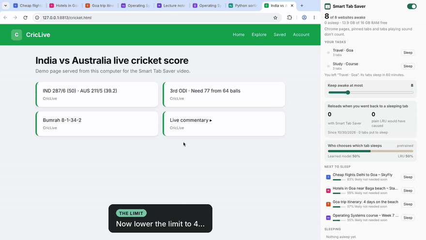

# Smart Tab Saver

A Chrome extension that keeps only the tabs you need awake, using a policy learned from Belady's optimal algorithm, plus task focus, predictive wake, away and handoff, green mode and call mode.

## Demo

[](docs/demo/smart-tab-saver-demo.mp4?raw=true)

**[Watch the full demo (4:21, MP4)](docs/demo/smart-tab-saver-demo.mp4?raw=true)**: the awake-tab limit, reloads compared with LRU, task focus, predictive wake, call mode, green mode and "Learn from my browsing".

Recorded in Chromium with the extension loaded unpacked. The websites are local stand-in pages, the grace period and task timer were shortened so effects show within seconds, and the battery event was sent by the demo script (the recording machine has no battery).

## Try it

1. Open `chrome://extensions` and turn on Developer mode.
2. Click **Load unpacked** and pick this folder.
3. Click the Smart Tab Saver icon in the toolbar to open the popup.

## Tests

The test suite runs in real Chromium under Xvfb (Linux):

```bash
tests/build.sh && tests/run.sh
```
